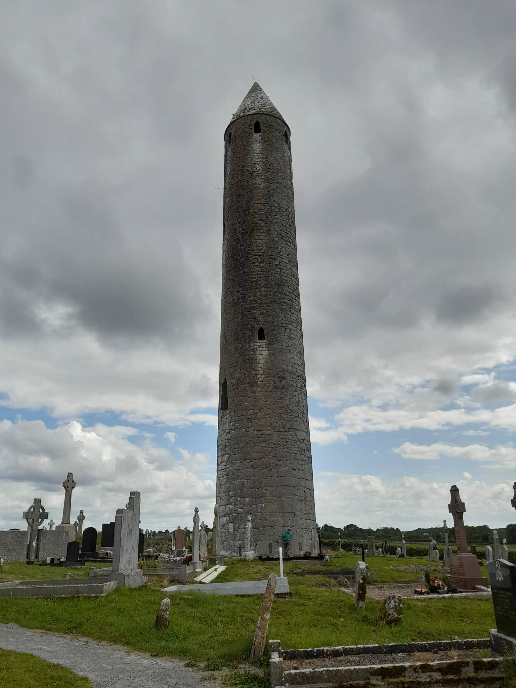
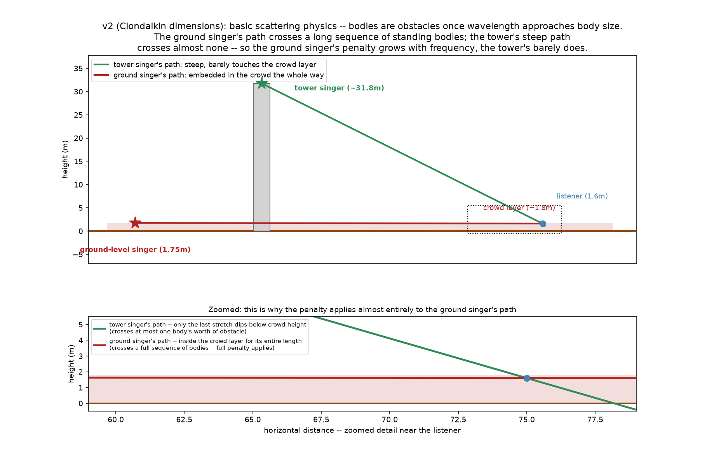
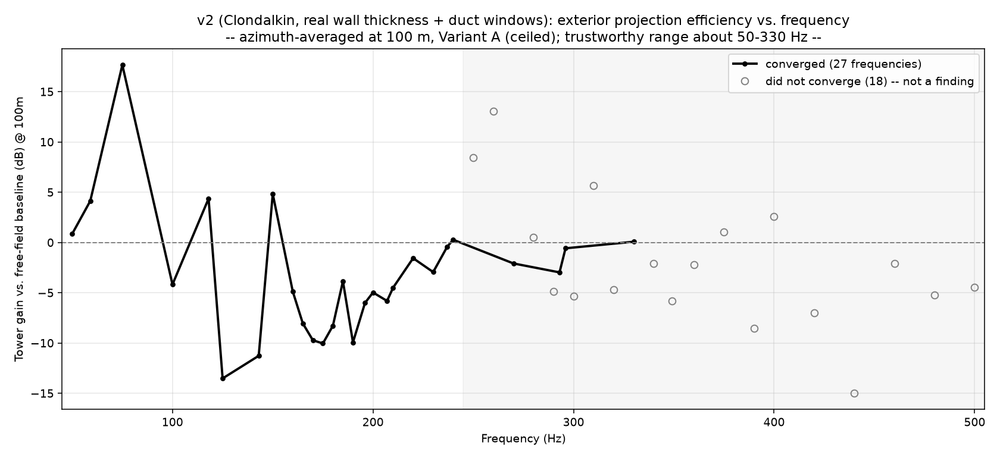
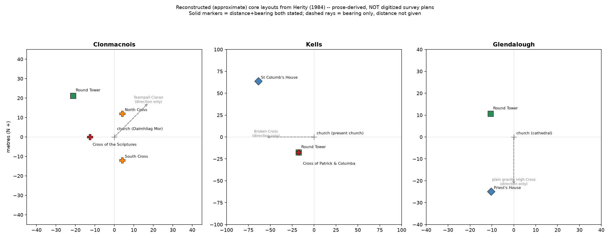

# Round tower acoustics



*Kilmacduagh round tower, Co. Galway. Photo: Ruth Flood, used with permission. (The model itself
is of Clondalkin, Co. Dublin.)*

Irish round towers (9th–12th century) have a top chamber with four windows facing the cardinal
points. This project asks a physical question about that chamber: **if one person stood inside
and chanted, how would the sound reach people gathered outside?** It models the chamber with
the boundary element method (BEM), using [bempp-cl](https://bempp.com) and
[gmsh](https://gmsh.info). The interior is solved first (how the voice drives each window), then
the exterior (how sound radiates from the windows out to the ground).

**Status: research model, two phases complete.** The numbers come with reliability flags, and
the flags matter; see [Reliability](#reliability).

## Findings (phase 2, Clondalkin)

- **A centred singer drives all four windows almost equally**: mean imbalance 0.04 dB, worst
  0.19 dB. This held in both phases, because it follows from the chamber's symmetry.
- **Height beats the crowd.** Compared with an equally loud singer at ground level, the voice in
  the tower arrives about **6–10 dB stronger** from 15 m out to about 1 km, because its path passes
  over the crowd rather than through it.

  

- **Where you stand matters as much as how far away you are.** The four windows produce strong
  directional interference. At some frequencies, two listeners on the same pilgrim ring hear
  sound levels more than 20 dB apart.
- **A strong low-frequency enhancement near 75 Hz**, somewhere between +9 and +18 dB over free
  field. Two independent BEM formulations agree it is real; they disagree on its exact size.

  

Full numbers: [phase2_clondalkin/v2_headline_readout.md](phase2_clondalkin/v2_headline_readout.md).

## Reliability

- **Validated against theory.** The interior model reproduces all 10 analytic modes of a rigid
  cylinder of the chamber's size ([v2_validation.md](phase2_clondalkin/v2_validation.md)).
  Reciprocity checks pass to 0.005%.
- **Trustworthy range about 50–330 Hz.** 18 of the 45 frequencies swept did not converge (most of
  them above 250 Hz). They are excluded from every headline number and drawn as hollow markers in
  the plot above. That range covers the vocal range of interest (about 110–250 Hz).
- **Exact depths of sharp features are uncertain.** The direction of the effects is consistent
  between methods; the precise dB values at the sharpest peaks and troughs are not.
- **Assumptions:** a voice of 84 dB at 1 m, chamber floor 30 m above the ground, rigid stone,
  rigid flat ceiling at the corbel line.

## Two phases

**[Phase 1: generic tower](phase1_generic_tower/)** used general round-tower proportions. It
began with a dome-shaped roof, then switched to a cone once a 3D scan of Clondalkin's interior
showed the roof is conical. Its review rounds found and fixed a sampling error: 8 directions at 45°
lined up with the tower's four-fold symmetry and exaggerated its peaks. The write-up,
[PROJECT_SUMMARY_FOR_REVIEW.md](phase1_generic_tower/PROJECT_SUMMARY_FOR_REVIEW.md), keeps the
superseded numbers in place, marked as such.

**[Phase 2: Clondalkin](phase2_clondalkin/)** rebuilt the model on measurements of one real tower,
from a Royal Irish Academy archive cross-section of Clondalkin. That showed phase 1's chamber was
about twice the real internal diameter, because the 0.745 m wall had been left out. Phase 2 models
the wall, the four windows as rectangular ducts through it, and the ceiling. Every
frequency-domain result was recomputed. The rebuild specification is in
[rebuild_spec.md](phase2_clondalkin/rebuild_spec.md), and the comparison with phase 1 in
[v2_diff_vs_v1.md](phase2_clondalkin/v2_diff_vs_v1.md).

Phase 1's frequency-domain numbers are superseded. Its method, review history and figures are kept
as the record of how the model got here.

## Site context

The listening positions come from real monastic sites: tower-to-church distances of 15–30 m at
Clonmacnois, Kells and Glendalough (Herity 1984), and two pilgrim rings at 45 m and 91.5 m. The
site plans in [site/](site/) are reconstructed from Herity's written descriptions, not digitised
survey plans.



## Running

```bash
python3 -m venv .venv && source .venv/bin/activate
pip install -r requirements.txt

cd phase2_clondalkin
python v2_check_watertight.py v2_mesh_interior_A.msh   # seconds
python v2_validate_interior_modes.py                   # interior mode check, about 20 min
python v2_plot_headline_curve.py                       # replot from saved results
```

Plots and summaries rebuild from the saved CSVs in seconds. **The full exterior sweep
(`solve_tower_radiation_v2.py`) takes hours.** Each script writes into its own folder and
overwrites the file it produced.

## Next steps

- Variant B (open roof, chamber continuous with the cone) and a timber ceiling
- Wall-thickness sensitivity runs (0.64 m and 0.813 m)
- Better convergence above 250 Hz (finer mesh or a preconditioner)
- The crowd as an absorbing boundary instead of a scattering estimate
- Water as a reflecting plane, for lakeside sites

## Licence

Code: MIT, see [LICENSE](LICENSE). Text, figures and results may be reused with attribution. The
photograph is © Ruth Flood and is not covered by either. To cite this work, see
[CITATION.cff](CITATION.cff).
